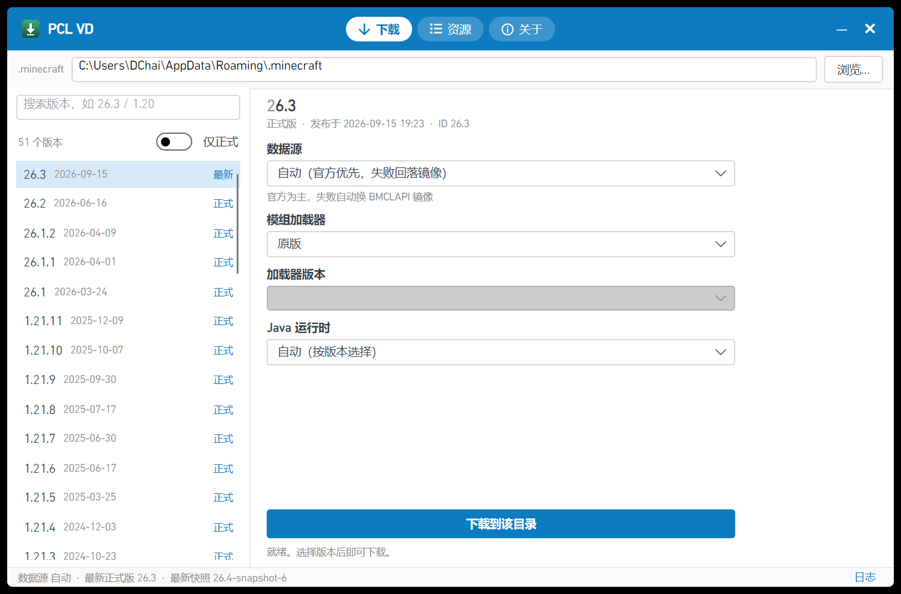
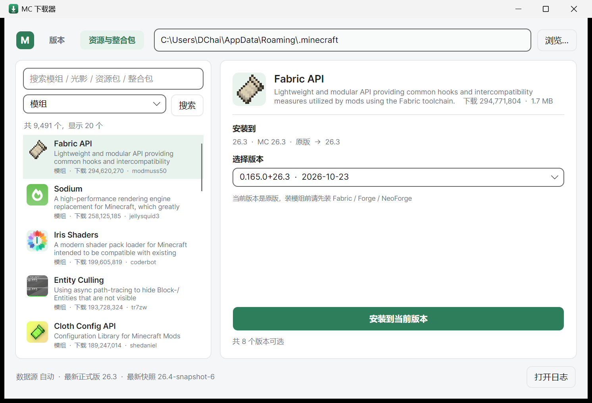

# PCL VD（PCL Version Download）

> **本项目是第三方基于 Plain Craft Launcher（PCL）独立进行的二次创作**，与 PCL 官方无关，
> 也不是 PCL 的官方后续版本。原作者：龙腾猫跃（LTCat）。
> 依《PCL 存储库合理使用指南》「重度使用」条款使用，指南全文见 [LICENCE-PCL.txt](LICENCE-PCL.txt)。

跨平台 Minecraft Java 版**版本下载器**：指定一个 `.minecraft` 目录，把 1.13 及以上任意版本
（含 2026 年 Mojang 改的新命名 `26.1` / `26.2` / `26.3`）连同 **Fabric / Forge / NeoForge** 装进去。



产出的目录结构严格遵循官方启动器约定，装完可以直接被官方启动器、Prism Launcher 等识别。

## 资源与整合包（Modrinth 直连）



第二个页签「资源与整合包」直连 [Modrinth API v2](https://api.modrinth.com/v2/search)（免 key，限流 300 次/分钟，
客户端自己按 200ms 间隔限速）：

- **模组 / 光影 / 资源包 / 整合包** 四类搜索，搜索框按回车即可（不用点按钮）
- **游戏版本 + 加载器** 可独立筛选（默认「跟随当前实例」，也可选「全部版本 / 全部加载器」或具体版本、Fabric / Forge / NeoForge / Quilt）；筛选和实例不一致时会明确提示「装进去不会生效」
- **中文关键词自动翻译**：Modrinth 只认英文，`机械动力 → create`、`钠 → sodium`、`虹彩 → iris` 等 19 个常见模组名内置对照，认不出来的会提示改用英文
- 列表和详情都显示真实图标（`icon_url`，并发 4 个下载，同 URL 共享同一个 Task）
- 装模组自动补齐 `required` 依赖（如 Iris → Sodium），并跳过已有的同版本依赖
- 每个实例写一份 `.mcdl-resources.json` 记录「项目 → 版本 → 文件」，重复安装会替换而不是并存
- 光影装进 `shaderpacks/`、资源包装进 `resourcepacks/`（两者不受加载器影响）
- `.mrpack` 整合包：按 `dependencies` 自动装好对应 Fabric/Forge/NeoForge 版本 → 下载 `files[]` → 解压 `overrides/`

资源按 **版本隔离** 落在 `versions/<版本 id>/mods|shaderpacks|resourcepacks/`（HMCL / PCL2 同一套约定），
不同版本互不污染。

## 图标


绿色圆角方块 + 白色下载箭头 + 底部托盘条，与应用主题色 `#2E7D5B` 同族。

- 源文件：`src/Mcdl.App/Assets/app.ico`（16/20/24/32/40/48/64/128/256 共 9 个尺寸）
- 编译进 exe：`<ApplicationIcon>Assets\app.ico</ApplicationIcon>`
- 窗口图标：`MainWindow.axaml` 里的 `Icon="/Assets/app.ico"`
- 重新生成：`python tools/icon/make_icon.py src/Mcdl.App/Assets docs`（设计稿与三套备选见 `docs/icon-sheet.png`）

---

## 技术栈

| 层 | 选择 | 说明 |
|---|---|---|
| 运行时 | .NET 8 | 只需要安装 .NET SDK（约 200 MB），**不需要 Visual Studio** |
| UI | Avalonia 11.3 | 单代码库跑 Windows / Linux / macOS，Fluent 主题 |
| 下载 | 自研分片引擎 | 行为对齐 PCL2 的 `NetTaskManager`，见下文 |
| 其他依赖 | 无 | 没有 CmlLib、没有 Java 运行时依赖 |

> 关于 CmlLib：原计划用它兜底，但它的价值集中在我们必须自己掌控的两处——传输层（要按 PCL2 重做）
> 和 installer 封装（直接调官方 installer 更可控）。26.x 的新 schema 又需要自己适配，
> 所以最终零第三方依赖。Forge/NeoForge 用的"轮子"是它们自己的官方 installer，没有重写。

## 构建与运行

```bash
# 只需要 .NET 8 SDK
dotnet build src/Mcdl.App/Mcdl.App.csproj -c Release

# 跨平台发布（自带运行时，用户端不用装任何东西）
dotnet publish src/Mcdl.App/Mcdl.App.csproj -c Release -r win-x64   --self-contained -p:PublishSingleFile=true
dotnet publish src/Mcdl.App/Mcdl.App.csproj -c Release -r linux-x64 --self-contained -p:PublishSingleFile=true
dotnet publish src/Mcdl.App/Mcdl.App.csproj -c Release -r osx-arm64 --self-contained -p:PublishSingleFile=true
```

命令行冒烟测试（不经 UI，直接跑完整安装流程）：

```bash
dotnet run --project tools/Mcdl.Smoke -- --version 26.3 --dir E:\mc-test
dotnet run --project tools/Mcdl.Smoke -- --version 26.3 --dir E:\mc-test --loader fabric
dotnet run --project tools/Mcdl.Smoke -- --version 26.3 --dir E:\mc-test --loader neoforge
```

## 下载引擎：和 PCL2 对齐的地方

参考 `Meloong-Git/PCL` 的 `Modules/Base/ModNet.vb`（`NetTaskManager`）实现：

| PCL2 行为 | 本项目对应实现 |
|---|---|
| 全局线程上限 = 设置项 + 1，不是每文件 | `SegmentedDownloader.MaxThreads`（默认 32），`Session._active` 全局计数 |
| 只切"剩余量最大"的分片，从剩余区间的尾部 40% 切 | `TrySplitLocked`：`startAt = seg.Start + seg.Done + remain * 0.6` |
| 分片剩余量 < 256 KB 就不再切 | `PieceLimit = 256 * 1024` |
| 总速度够快就不再开新线程 | `SplitSpeedThreshold = 512 KB/s`，速度达标只在有空闲线程时才补刀 |
| `Range: bytes=start-` 开放式请求 + 链式端点截断写入 | `FileJob.EndOfLocked` 由链表下一个分片起点决定，写入时 `remaining` 截断 |
| 严格校验 `ContentLength == 文件大小 - 起始点`，不符判 Range 不支持 | `RangeNotSupportedException` → 该源降级单线程，分片并回前一段 |
| 多下载源轮换、坏源禁用 | `DownloadFile.Urls` 多地址 + 失败计数 |
| 分片各自写临时文件，最后按顺序合并 | `FinishAsync`：`<target>.mcdl-part` → 校验 → rename |
| SHA1 校验失败重试三次 | `MaxFileRetries = 3`，退避 500 ms × 次数 |
| 16 KB 读缓冲 | `ArrayPool` 16 KB |
| 已存在且校验通过的文件直接跳过 | `PrecheckAsync`（断点续传 / 增量更新的基础） |

## 目录结构

```
src/Mcdl.Core/
  McVersion.cs                 混合版本号比较（26.3 > 1.21.11）
  Manifest.cs                  版本清单 + HTTP
  Net/SegmentedDownloader.cs   分片下载引擎
  Versions/VersionJson.cs      版本 JSON 模型 + rules 求值
  Versions/VanillaInstaller.cs 客户端 / 依赖库 / 资源 / 日志配置
  Versions/MinecraftPaths.cs   标准 .minecraft 布局 + 镜像源
  Loaders/LoaderCatalog.cs     Forge / NeoForge / Fabric 版本清单
  Loaders/LoaderInstallers.cs  Fabric profile 合成；Forge/NeoForge 跑官方 installer
  Java/JavaRuntimeManager.cs   从 Mojang 官方清单下载 JRE（8/16/17/21/25）
src/Mcdl.App/                  Avalonia UI（MVVM）
tools/Mcdl.Smoke/              命令行冒烟测试
```

## 已验证（Windows 11 x64，本机实测）

| 项目 | 结果 |
|---|---|
| **GUI 点按钮完整安装 26.3** | 5224 个文件 / 586 MB / **48.5 秒**，平均 **12.09 MB/s**，0 失败 |
| 26.3 原版（命令行） | 5224 文件 / 586.8 MB / 64.9 秒，峰值 **26.5 MB/s**，SHA1 全绿 |
| 1.13.2 原版（版本下界） | 46 文件 / 57 MB / 4.3 秒，峰值 45 MB/s，正确识别需要 Java 8 |
| 增量重跑 | 77 个原版文件全部跳过，0.5 秒 |
| Fabric 26.3 | `fabric-loader-0.20.1-26.3`，7 个依赖，秒级完成 |
| Forge 26.3 | `26.3-forge-66.1.0` 端到端装成功（installer 退出码 0） |
| NeoForge 26.3 | `neoforge-26.3.0.95` 端到端装成功（自动喂依赖 + 官方 installer 退出码 0） |
| Java 自动配置 | `java-runtime-epsilon` 25.0.1，411 个文件 / 100 MB，下载后可直接执行 |
| 跨平台发布 | `linux-x64` 73 MB、`osx-arm64` 79 MB 单文件自包含包均发布成功 |
| Modrinth 搜索 | 26.3 + fabric 的模组命中 9,024 个；光影 342 个；资源包 6,497 个（facet 实测有效：全量 47,554 → 26.3 为 9,024） |
| 装模组（含依赖） | Sodium 1.82 MB → `mods/`；Iris 2.72 MB + 自动带上 Sodium，重复的 Sodium 记为「跳过」 |
| 光影 / 资源包 | Complementary Reimagined → `shaderpacks/`；Fresh Animations → `resourcepacks/` |
| 整合包 `.mrpack` | Fabulously Optimized：建 `fabric-loader-0.19.5-26.2` 实例，**51 个文件 / 42.84 MB + 57 个 overrides**，0 失败 |
| 中文搜索别名 | `机械动力` → 自动改搜 `create`，3,516 个结果，第一条就是 **Create**；`钠` + 26.3 + fabric → 32 个，第一条 **Sodium** |

**数据源实测（「国内镜像 BMCLAPI」+ 1.14.4 原版）**：42 个文件 / 59.57 MB / 40.6 秒 / 0 失败，平均 2.66 MB/s。
镜像的 Maven 端点对大文件的 Range 请求不可靠（实测会超时或返回截断内容），所以「国内镜像」模式下
库文件自动降为单线程；资源对象和客户端 jar 的 Range 正常，仍然分片。

## 数据源

界面里可切换三种，改完会立刻重新拉一次版本清单：

| 选项 | 行为 |
|---|---|
| 自动（默认） | 官方优先，失败自动回落 BMCLAPI |
| 官方（Mojang） | 只连 Mojang，速度取决于你的网络 |
| 国内镜像（BMCLAPI） | 清单、版本 JSON、依赖库、资源对象、Fabric meta、Forge 元数据全部走 `bmclapi2.bangbang93.com`，官方地址兜底 |

## 2026 年的几个坑（代码里已处理）

1. **版本号混合**：`26.3`、`26.1.2`、`26.4-snapshot-5`、`26w14a`、`1.21.11` 混在一份清单里，只能按数值段比较。
2. **`arguments.default-user-jvm`**：26.x 新增，官方自带内存/GC 参数，以后接启动时必须优先读它。
3. **natives 不再解压**：26.x 的 natives 是独立 artifact 且没有 `extract` 规则，直接进 classpath。
4. **Forge 元数据搬家**：`promotions_slim.json` 在 Reposilite 域名下已 404，改装 `maven-metadata.xml`。
5. **NeoForge 版本号带 MC 前缀**：`26.3.0.95`，不能像 `21.1.x` 那样只按 minor 匹配。
6. **Fabric 的 `releaseTime` 是 `+0000` 而非 `+00:00`**，严格 ISO 解析会炸，按字符串存。
7. **官方 installer 的下载器会踩 DNS 污染**：`java.net.SocketTimeoutException` → 从 installer jar 里的
   `install_profile.json` 读出它要的依赖，用我们自己的引擎先下进 `libraries/`，安装器只做本地 patch。

## 已知限制 / 下一步

- [ ] 只有"下载"，还不能启动游戏（下一步：参数拼装、natives 解压、离线/微软登录）
- [ ] CurseForge 源未接（需用户自备 API key；实测无 key 一律 403）
- [ ] 数据包要装进具体世界，UI 还没做世界选择
- [ ] 资源页没有"已装列表 / 卸载 / 更新检查"入口（Core 里 `Uninstall` 已就绪）
- [ ] `mac-os-arm64` 没有 jre-legacy，1.13~1.16 在 Apple Silicon 上需要 Rosetta 或手动指定 Java
- [ ] 校验/修复已有 `.minecraft` 的 UI 入口
- [ ] 单元测试（目前靠 `tools/Mcdl.Smoke` 端到端验证）
